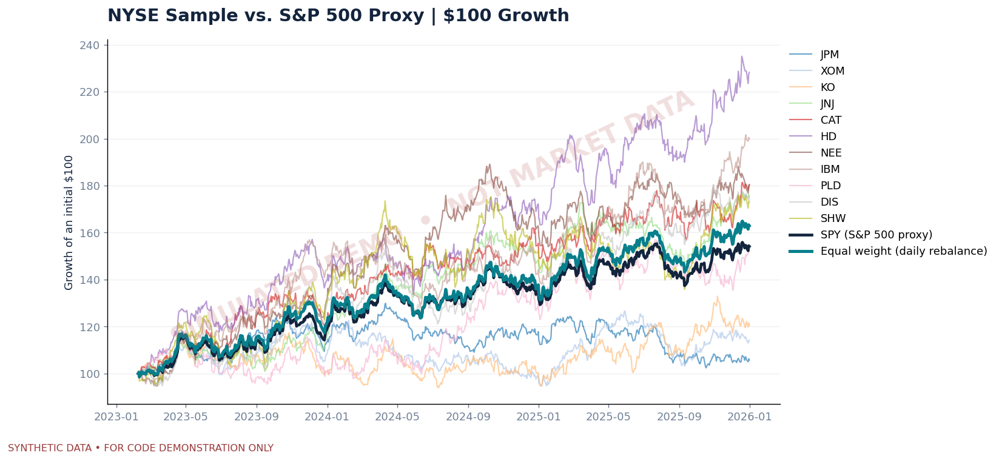

# NYSE Market Pulse 📈

### New York Stock Exchange | Sector Performance, Market Risk & Portfolio Analytics

**Finance × Data Analytics | Python · Pandas · Risk Metrics · Data Visualization · Streamlit**

[](https://github.com/notregularjolpai/NYSE-Market-Pulse-Analysis/actions/workflows/ci.yml)

> **Project status:** Historical GitHub Actions research and independent data checks have passed; the Streamlit dashboard can fetch and cache verified historical prices when available. Hosting still requires the owner to deploy the app. Real-market outputs are shared only as generated research artifacts, **not** as a committed Yahoo price-history dataset. The preview image below is a **synthetic example**; it is *not* a historical market chart.

## Phase 2 — Interactive dashboard (deployment-ready source)

The [Streamlit dashboard](app.py) now loads **verified historical adjusted market prices on demand**, without expecting a local Yahoo CSV in the public repository. Data are cached for **one hour**, date and ticker filters re-compute visualizations without another request, and a manual refresh is available. Visitors can explore growth of $100, annualized returns, realized volatility, drawdowns, company risk/return, correlations and **11-company sample** breadth. The dashboard checks provider coverage/freshness and **never substitutes synthetic data when a live download fails**.

- **Default source:** historical Yahoo Finance prices for 11 selected NYSE stocks plus the SPY benchmark; **not intraday quotes**.
- **Explicit optional source:** prominently labeled synthetic demo, for offline product tours and CI smoke tests.
- **No raw-provider-data distribution:** price history is held in the Streamlit cache; visitors can download only derived metrics.
- **Deployment:** the app's source and configuration are ready. The repository owner must separately sign in and deploy it to Streamlit Community Cloud. **No live Streamlit URL has been created or verified yet.**

**[Step-by-step Streamlit deployment instructions](docs/streamlit_deployment.md)** · [Dashboard source](app.py) · [Dashboard data & validation](marketpulse/dashboard_data.py)

To run the dashboard locally:

```bash
python -m pip install -r requirements.txt
streamlit run app.py
```

If the provider is unavailable, the dashboard displays an error instead of invented historical figures. Use the sidebar's **Synthetic demonstration** option to inspect functionality separately.

## Real historical research — independently verified

A GitHub Actions run **successfully downloaded and verified real historical adjusted stock prices**, from **January 3, 2023 to October 21, 2026** (954 common trading sessions). Results from this dated run include:

| Historical metric | SPY (S&P 500 ETF) | 11-stock NYSE sample* |
|:--|--:|--:|
| Cumulative return | **112.8%** | **79.8%** |
| Annualized return (CAGR) | **22.1%** | **16.8%** |
| Annualized volatility | **14.9%** | **13.5%** |
| Maximum drawdown | **-18.8%** | **-15.3%** |
| Historical Sharpe (0% risk-free) | **1.42** | **1.22** |

*The sample holds eleven hand-selected NYSE companies, one per GICS sector, **rebalanced daily** with no trading costs. Not the full NYSE or a sector-index portfolio. All figures are historical, provider-derived, and subject to revision; not investment advice.*

**Read the [verified October 21, 2026 research findings](docs/verified_historical_2026-10-21.md)** or inspect the [successful live GitHub Actions run](https://github.com/notregularjolpai/NYSE-Market-Pulse-Analysis/actions/runs/39723376151) for the dated research brief, charts, QA metadata and verification artifact. The following home-page chart is a **clearly marked synthetic visualization**, not this real-data result.



## Executive summary

**Business question:** *How did NYSE-listed companies in different sectors perform relative to the broader US equity market, and what can historical risk and return statistics tell us about diversification?*

This research-style portfolio project evaluates **11 NYSE-listed equity examples representing all 11 major GICS sectors**. It compares the selected companies and a simple daily-rebalanced equal-weight portfolio with **SPY**, the NYSE Arca-listed ETF that tracks the S&P 500. The goal is to evaluate market behavior and investment risk using reproducible analysis, not predict stock prices.

### Project deliverables

- **Real historical price pipeline:** `yfinance` daily dividend/split-adjusted closing prices; validation of missing observations and ticker coverage.
- **Equity performance:** growth of $100, cumulative and annualized returns, and sector-representative ranking.
- **Risk analytics:** volatility, realized Sharpe ratio, SPY beta, rolling volatility, maximum drawdown, and correlation.
- **Portfolio comparison:** equally weighted 11-stock sample rebalanced every trading session vs. SPY.
- **Sample breadth:** share of the 11 selected stocks with positive trailing 63-session returns.
- **Visual analysis:** six publication-ready charts; CSV exports; dated research brief and machine-readable run metadata.
- **Interactive dashboard:** Streamlit charts and downloadable metrics for a selected analysis window.
- **Quality controls:** automated pytest unit tests and a GitHub Actions offline build using reproducible synthetic data.

## Verified historical-data workflow

GitHub Actions provides a separate **[Historical Market Research](.github/workflows/historical-research.yml)** workflow to retrieve real data and generate a dated research brief. Its live-data job:

1. Requests daily dividend/split-adjusted prices for 11 selected NYSE stocks and SPY (start inclusive, end exclusive).
2. Checks all 12 symbols, at least 90 common dates, missing-session thresholds, positive values, data-window alignment, and freshness for near-current periods.
3. Independently reconciles published cumulative returns and annualized volatility against saved adjusted prices, verifies SPY beta/correlation, and validates drawdown ranges.
4. Uploads **only calculated research outputs** (metrics, charts, a dated report and run metadata) as an Actions artifact; raw provider prices remain excluded from the repository and artifact.
5. Writes the source, as-of date and SPY/sample metrics to the GitHub Actions run summary. **A job failure means no verified live results were produced**, not that the synthetic demo can stand in for them.

A fresh live-data run is triggered when the workflow changes or can be launched through **Actions → Historical Market Research → Run workflow**. See [Live Data Validation Protocol](docs/live_data_validation.md) for validation steps, known risks, and reproduction commands. Do not confuse chart dates, run execution dates, and current quotes.

## Coverage: 11 sectors, 11 NYSE companies

| Ticker | NYSE-listed company | Sector |
|:--|:--|:--|
| JPM | JPMorgan Chase | Financials |
| XOM | Exxon Mobil | Energy |
| KO | Coca-Cola | Consumer Staples |
| JNJ | Johnson & Johnson | Health Care |
| CAT | Caterpillar | Industrials |
| HD | Home Depot | Consumer Discretionary |
| NEE | NextEra Energy | Utilities |
| IBM | IBM | Information Technology |
| PLD | Prologis | Real Estate |
| DIS | Walt Disney | Communication Services |
| SHW | Sherwin-Williams | Materials |
| **SPY** | **S&P 500 ETF — NYSE Arca, benchmark only** | **Broad US market, not an NYSE constituent of this sample** |

**Scope is intentional:** one company per sector is not an NYSE sector index. SPY tracks a broader U.S. benchmark including stocks on multiple U.S. exchanges; this project does **not** analyze all NYSE stocks or the NYSE Composite Index.

## Quick start

Requirements: **Python 3.10–3.12 recommended**, internet access for real data.

```bash
# 1. Download the repository
 git clone https://github.com/notregularjolpai/NYSE-Market-Pulse-Analysis.git
 cd NYSE-Market-Pulse-Analysis

# 2. Install dependencies (a virtual environment is recommended)
 python -m pip install -r requirements.txt

# 3. Fetch HISTORICAL adjusted prices and produce figures/results
 python scripts/run_analysis.py --start 2023-01-01

# 4. Start an interactive dashboard using those saved prices
 streamlit run app.py
```

The live-data script saves generated outputs to `outputs/market/` and its local, unredistributed source CSV to `data/processed/adjusted_close.csv`. It uses the latest available provider price through the date before the *exclusive* end date. Yahoo requests may fail or be rate-limited; failures raise explicit errors instead of substituting fabricated prices.

To reproduce a fixed window, provide both dates explicitly:

```bash
python scripts/run_analysis.py --start 2023-01-01 --end 2026-01-01
```

To reanalyze the previously downloaded data without making fresh requests:

```bash
python scripts/run_analysis.py --use-cache
```

### Fully offline synthetic demonstration (clearly labeled)

```bash
python scripts/run_analysis.py --demo
streamlit run app.py
```

In Streamlit, select **Synthetic demo**. The demo uses seeded fabricated data for functionality checks and appearance previews. All output paths go under `outputs/demo/` and `data/demo/`, and rendered charts carry a visible synthetic-data watermark. **No demo returns should be interpreted as NYSE returns.**

## Analytical outputs

After running the historical pipeline, open:

| Output | Description |
|:--|:--|
| `outputs/market/research_brief.md` | Data-dated executive research report with methodological caveats |
| `outputs/market/performance_metrics.csv` | CAGR, volatility, Sharpe, drawdown, beta, SPY correlation |
| `outputs/market/daily_returns.csv` | Aligned daily simple returns |
| `outputs/market/monthly_returns.csv` | Derived monthly simple returns |
| `outputs/market/sample_breadth.csv` | Trailing 63-session sample-positive share |
| `outputs/market/run_metadata.json` | Provider, dataset type, tickers, time window, assumptions |
| `outputs/market/01_growth_of_100.png` | Adjusted-price wealth index |
| `outputs/market/02_risk_return.png` | Return vs volatility |
| `outputs/market/03_drawdowns.png` | SPY and daily-rebalanced sample drawdown |
| `outputs/market/04_correlation_matrix.png` | Daily return correlations |
| `outputs/market/05_sample_breadth.png` | Trailing 63-session breadth of this sample |
| `outputs/market/06_sector_representatives.png` | Returns of the chosen company per sector |

Generated **real-price exports are intentionally excluded from GitHub** to respect third-party data reuse terms; you can reproduce them locally by running the script.

## Finance methods at a glance

| Metric | Definition | Main use |
|:--|:--|:--|
| Compounded annual growth (CAGR) | `(Ending/Beginning)^(252/daily periods) − 1` | Historical realized growth |
| Annualized realized volatility | `std(daily returns) × √252` | Magnitude of return variability |
| Historical Sharpe | `(mean daily return × 252 − annual risk-free assumption) / annual volatility` | Return relative to volatility |
| Maximum drawdown | `min(wealth / historical peak − 1)` | Peak-to-trough loss risk |
| Beta vs SPY | `cov(stock, SPY) / var(SPY)` | Market sensitivity estimate |
| Sample market breadth | `% of 11 stock returns positive over 63 sessions` | Cross-sectional sample participation |

The **default risk-free assumption is 0%**, explicitly configurable through `--risk-free-rate 0.04` for an illustrative 4% annual rate. It is not a historical daily Treasury series. Portfolio weights reset to 1/11 every session; transaction costs and taxation are not modeled.

## Repository layout

```text
NYSE-Market-Pulse-Analysis/
├── app.py                      # Streamlit interactive dashboard
├── marketpulse/
│   ├── universe.py             # 11 NYSE companies + SPY benchmark
│   ├── data.py                 # Yahoo fetch, validation, synthetic demo
│   ├── analytics.py            # Historical performance & risk analytics
│   ├── charts.py               # Six labeled analytical charts
│   └── report.py               # Auto-generated research brief
├── scripts/run_analysis.py     # CLI entrypoint
├── notebooks/01_market_exploration.ipynb
├── docs/methodology.md         # Research design & limitations
├── docs/data_dictionary.md
├── docs/live_data_validation.md # Live source checks and reproduction
├── docs/verified_historical_2026-10-21.md # Dated, verified real-data snapshot
├── data/README.md
├── assets/demo_preview.png     # Synthetic illustration, not real market
├── tests/test_analytics.py
├── .github/workflows/ci.yml
├── .github/workflows/historical-research.yml
├── requirements.txt
└── LICENSE
```

## Testing

```bash
python -m pytest -q
python scripts/run_analysis.py --demo
```

Tests exercise return calculations, portfolio rebalancing, data validation, drawdowns, volatility, and reproducibility. Separate tests cover live-data audit boundaries, missing-data rejection and independent output reconciliation. The demo works without Yahoo data, while the Historical Market Research workflow requires a functioning provider connection.

## Research limitations and ethics

1. **Selection/survivorship bias:** this is a curated set of companies active at the time of selection, not a historical point-in-time NYSE universe. Avoid treating results as an investable strategy backtest.
2. **Market benchmark mismatch:** SPY is a broad S&P 500 ETF on NYSE Arca; it is not an NYSE-only index, and its holdings include securities listed on other exchanges.
3. **One ticker per sector:** each company is a representative case study, not a GICS sector index or sector average.
4. **Historical vs predictive:** returns, correlations, beta, and Sharpe depend on the chosen window and should not be extrapolated.
5. **Data conditions:** adjusted prices depend on third-party provider methods and may change with data corrections; dates with missing quotes are uniformly excluded, not forward-filled.
6. **Portfolio friction:** daily rebalancing ignores trading costs, tax, spread, market impact, and liquidity constraints.
7. **No data redistribution:** the repository includes no downloaded Yahoo price-history files. Price data use and access remain subject to provider terms.

**For education and research only — not investment advice.**

See [research methodology](docs/methodology.md) and [data dictionary](docs/data_dictionary.md).

## Author

**Ashraful Enam** · Finance & Data Analytics

[GitHub](https://github.com/notregularjolpai) · [LinkedIn](https://www.linkedin.com/in/ashraful-e-4b1a2b255/)

## References

- [NYSE-listed stock directory](https://stockanalysis.com/list/nyse-stocks/)
- [yfinance official download documentation](https://ranaroussi.github.io/yfinance/reference/api/yfinance.download.html)
- [State Street SPY: index objective and NYSE Arca listing](https://www.ssga.com/us/en/individual/etfs/state-street-spdr-sp-500-etf-trust-spy)
- [Yahoo Finance usage disclaimer (see yfinance package)](https://pypi.org/project/yfinance/)

**Code license:** MIT. Historical pricing is **not** covered by that code license.
